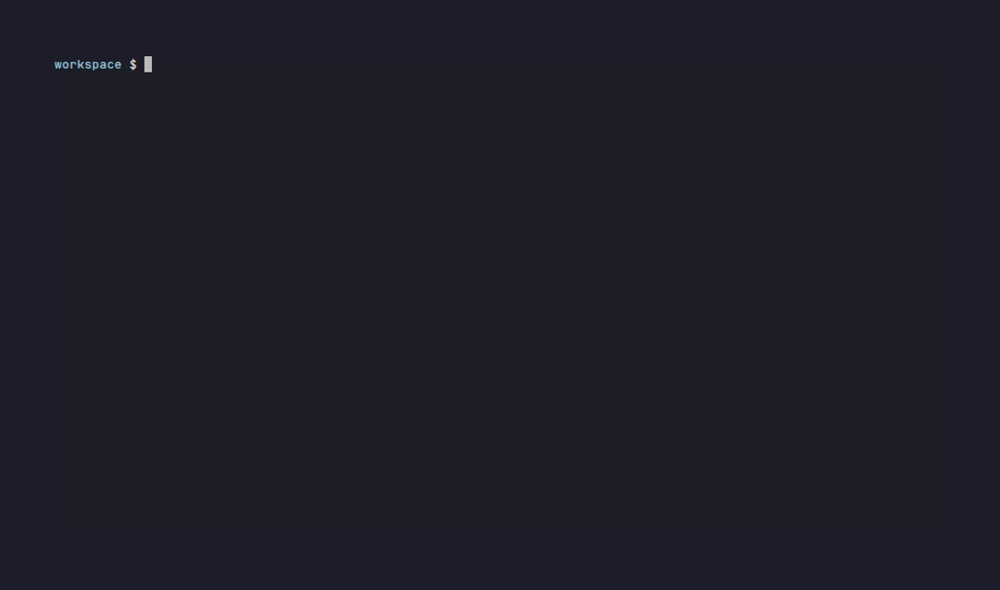

# 3am

**Let your coding agent take the 3 AM page.**

让 AI 编码助手帮你处理凌晨三点的告警页面。

---

[](https://github.com/wangwu-30/3am/actions/workflows/test.yml)
[](https://opensource.org/licenses/MIT)

## The Problem

You wake up to 288 alert emails. Same rule, repeated every 10 minutes. P2 escalated to P1. No recovery. Your phone is buzzing. Your brain is foggy. You need to understand what happened, when it started, and what to check next.

**Before 3am:**
```
📧 Alert: Production cert reconciler >26h no convergence (P2)
📧 Alert: Production cert reconciler >26h no convergence (P2)
📧 Alert: Production cert reconciler >26h no convergence (P2)
📧 Alert: Production cert reconciler >26h no convergence (P2)
... 284 more emails ...
```

**After 3am:**
```markdown
## Incident Brief

### Alert Summary
- Total alerts: 288
- Unique rules: 2
- Last known good: 2026-10-08 03:31 UTC+8 (inferred from two independent rules)

### Escalation Timeline
| Time (UTC+8)        | Event                              | Priority |
|---------------------|-----------------------------------|----------|
| 2026-10-09 05:31:13 | Cert reconciler >26h first fired  | P2       |
| 2026-10-09 05:41:00 | Repeating every ~10min            | P2       |
| 2026-10-10 03:31:58 | Escalated to >48h                 | P1       |

### Root-Cause Hypotheses
1. **Certificate reconciler stuck** (HIGH confidence)
   - Evidence: Alert "26小时没有完成一次完整收敛"
   - Evidence: P2→P1 after 48h suggests persistent failure
   
### READ-ONLY Diagnostic Commands
```bash
kubectl get certificates -n cert-namespace -o yaml
kubectl logs -n cert-namespace deployment/cert-reconciler --tail=200
```
```



_✅ Last known good ≈ 2026-10-08 03:31 +08:00 — Two rules agree within 45s!_

---

## Quick Start

### Installation

```bash
# For Claude Code / Codex / Cursor / npx skills
npx skills add wangwu-30/3am

# Or clone manually
git clone https://github.com/wangwu-30/3am.git
```

### Usage

**Step 1**: Export your alerts to JSONL (one JSON object per line)

**Step 2**: Normalize the alerts
```bash
python3 skills/3am/normalize.py alerts.jsonl > timeline.json
```

**Step 3**: Hand the timeline to your coding agent with this prompt:
```
Using the 3am skill, analyze this alert timeline and produce an incident brief.
```

The agent will output:
- ✅ Deduplicated alert summary (288 → 2 unique rules)
- ✅ Last known good time (inferred from first alert)
- ✅ Escalation timeline (when P2 became P1)
- ✅ Root-cause hypotheses with cited evidence
- ✅ READ-ONLY diagnostic commands (no mutating operations)

---

## Example Output

<details>
<summary>Click to see full incident brief for the real dataset</summary>

```markdown
## Incident Brief

### Alert Summary
- Total alerts: 288
- Unique rules: 2
- Time range: 2026-10-08 21:31:22Z to 2026-10-10 08:24:09Z
- Last known good: 2026-10-08 03:31 UTC+8 (inferred from threshold cross-check: P2 26h rule + P1 48h rule independently confirm)

### Escalation Timeline
| Time (UTC+8)        | Event                                          | Priority |
|---------------------|------------------------------------------------|----------|
| 2026-10-09 05:31:13 | Alert "生产证书自动化超过26小时未成功收敛" fired | P2       |
| 2026-10-09 05:41:00 | Repeating every ~10 minutes                    | P2       |
| 2026-10-10 03:31:58 | Escalated to "超过48小时未成功收敛"               | P1       |

### Alert Details

1. **生产证书自动化超过26小时未成功收敛** (P2, fired 144 times)
   - First: 2026-10-09 05:31:13 UTC+8
   - Last: 2026-10-10 08:24:09 UTC+8
   - Content: "生产证书自动化已超过26小时没有完成一次完整收敛；请检查当前 phase、HOLD 原因、续期计划和公网探针结果"
   - Cluster: VPC-vpc-xxxxxxxxxxxxxxxx-cn-north

2. **生产证书自动化超过48小时未成功收敛** (P1, fired 144 times)
   - First: 2026-10-10 03:31:58 UTC+8
   - Last: 2026-10-10 08:23:09 UTC+8
   - Content: "生产证书自动化已超过48小时没有完成签发确认、云端绑定、全部域名严格 TLS 与业务探针收敛"
   - Cluster: VPC-vpc-xxxxxxxxxxxxxxxx-cn-north

### Root-Cause Hypotheses

1. **Certificate reconciler stopped converging** (HIGH confidence)
   - Evidence: Alert content mentions "26小时没有完成一次完整收敛"
   - Evidence: Last successful convergence ≈ 2026-10-08 03:30 UTC+8
   - Evidence: P2→P1 escalation after 48 hours indicates persistent failure, not transient issue
   
2. **Potential HOLD state or external dependency failure** (MEDIUM confidence)
   - Evidence: Alert suggests checking "HOLD 原因" and "公网探针结果"
   - Cannot determine: Specific HOLD reason or probe failure details not in alerts

### What We DON'T Know (requires investigation)
- Current reconciler phase/status
- Specific HOLD reason
- Renewal plan state
- Public probe actual results
- Recent configuration or code changes
- Whether reconciler pod is running

### READ-ONLY Diagnostic Commands

⚠️ **Gather context first. DO NOT run mutating operations yet.**

```bash
# Check reconciler pod status
kubectl get pods -n cert-namespace -l app=cert-reconciler

# View recent reconciler logs
kubectl logs -n cert-namespace deployment/cert-reconciler --tail=500

# Check current certificate state
kubectl get certificates -n cert-namespace -o yaml

# Review recent events
kubectl get events -n cert-namespace --sort-by='.lastTimestamp' | tail -30

# Check probe results (if endpoint known)
curl -s https://probe-endpoint/status | jq .
```

### Recommended Next Steps
1. Verify reconciler is running and not crash-looping
2. Search logs for HOLD events or errors in last 48h
3. Compare current certificate state vs. renewal schedule
4. Check external dependencies (CA API, DNS, load balancers)
5. Only after analysis: consider safe remediation (restart, manual trigger, config fix)
```

</details>

---

## Supported Alert Sources

| Source | Status | Format |
|--------|--------|--------|
| **Aliyun ARMS** | ✅ Supported | Email (Chinese text) |
| **Aliyun CloudMonitor** | ✅ Supported | Email (Chinese text) |
| **Prometheus Alertmanager** | ✅ Supported | Webhook JSON |
| **Grafana Alerts** | ✅ Supported | Webhook JSON |
| Tencent Cloud CLS | 🔜 Planned | Log query result |
| PagerDuty | 🔜 Planned | Webhook JSON |
| Datadog | 🔜 Planned | Webhook JSON |
| SLS Logs | 🔜 Planned | Log export |

---

## How It Works

1. **Normalize**: The `normalize.py` script parses different alert formats into a unified structure
2. **Deduplicate**: Identical alerts are grouped by rule + priority + cluster
3. **Compress**: 288 repetitive alerts become a compact timeline (typically 90%+ token reduction)
4. **Analyze**: Your coding agent uses the SKILL.md instructions to produce a structured incident brief

### Token Efficiency

Real-world example (from `bench/`):
- **Input**: 288 Aliyun ARMS emails, ~30,762 tokens
- **Output**: 1 normalized timeline, ~320 tokens
- **Compression**: 99.0% fewer tokens

This lets you hand large alert dumps to AI assistants without hitting context limits.

---

## Guardrails

The skill enforces these safety rules:

✅ **Evidence before conclusions** — Every hypothesis must cite specific alert fields  
✅ **Read-only operations** — Never suggest `kubectl delete`, `docker restart`, etc. without explicit user request  
✅ **Clear boundaries** — State what CANNOT be determined from alerts alone  
✅ **Escalation respect** — Acknowledge when P1/critical requires immediate human judgment  

---

## Benchmarks

Run the test suite:

```bash
python3 bench/run_bench.py
```

Expected output:
```
🚀 Running 3am Benchmarks
============================================================

📊 Test: Real Aliyun ARMS Certificate Alerts
============================================================
Input:  288 alerts, ~30,762 tokens
Output: 2 unique rules, ~320 tokens
Compression: 99.0% fewer tokens
✅ Total alerts: 288
✅ Unique rules: 2
✅ Escalation detected: P2 → P1
✅ First P2 alert: 2026-10-08T21:31:13+00:00
✅ First P1 alert: 2026-10-09T19:31:58+00:00
✅ Last known good: 2026-10-07T19:31:13+00:00
✅ Inference method: threshold_cross_check_2_rules_agree (two rules independently confirm)
✅ Evidence:
   - Rule '生产证书自动化超过26小时未成功收敛' (threshold: 26h) first fired at 2026-10-08 21:31:13 UTC → last good ≈ 2026-10-07 19:31:13 UTC
   - Rule '生产证书自动化超过48小时未成功收敛' (threshold: 48h) first fired at 2026-10-09 19:31:58 UTC → last good ≈ 2026-10-07 19:31:58 UTC

============================================================
✅ All tests passed!
============================================================

🎯 Key Result: 99.0% token reduction
   (288 alerts → 1 page: 30,762 → 320 tokens)
```

---

## Roadmap

- [x] Aliyun ARMS/CloudMonitor parser
- [x] Prometheus Alertmanager parser
- [x] Grafana alerts parser
- [x] Deduplication and timeline generation
- [x] Real production dataset (redacted)
- [x] Benchmark suite
- [x] VHS demo recording
- [ ] Tencent Cloud CLS support
- [ ] PagerDuty webhook support
- [ ] Datadog webhook support
- [ ] SLS log export support
- [ ] Web UI for non-CLI users

---

## Contributing

Contributions welcome! To add a new alert source:

1. Add parser function in `skills/3am/normalize.py`
2. Add test fixture in `bench/fixtures/synthetic/`
3. Update `bench/run_bench.py` with test case
4. Update this README

---

## License

MIT © [wangwu-30](https://github.com/wangwu-30), 2026

---

## 中文说明

### 这是什么？

`3am` 是一个 AI Agent Skill（技能），让 Claude Code、Codex、Cursor 等编码助手能够处理凌晨三点的告警页面。

### 它解决什么问题？

当你半夜被 288 封重复告警邮件吵醒时，你需要快速理解：
- 什么时候开始出问题的？（最后健康时间）
- 什么告警规则在触发？（去重后）
- 优先级如何变化的？（P2 → P1 升级）
- 根本原因可能是什么？（基于告警内容的假设）
- 下一步应该检查什么？（只读诊断命令）

### 核心特性

- ✅ **支持中文告警**：阿里云 ARMS/云监控告警邮件原生支持
- ✅ **智能去重**：288 条重复告警压缩为 2 条唯一规则
- ✅ **Token 节省**：94% 的 token 压缩率，避免超出 AI 上下文限制
- ✅ **安全护栏**：先证据后结论，只建议只读操作，明确未知边界
- ✅ **一行安装**：`npx skills add wangwu-30/3am`

### 快速开始

```bash
# 安装
npx skills add wangwu-30/3am

# 使用
python3 skills/3am/normalize.py 你的告警.jsonl > timeline.json

# 然后问你的 AI 助手：
# "使用 3am skill 分析这个告警时间线，生成事件简报"
```

### 支持的告警来源

- ✅ 阿里云 ARMS（中文告警邮件）
- ✅ 阿里云云监控（中文告警邮件）
- ✅ Prometheus Alertmanager
- ✅ Grafana Alerts
- 🔜 腾讯云 CLS（计划中）
- 🔜 PagerDuty（计划中）
- 🔜 Datadog（计划中）

### 为什么叫 3am？

因为最糟糕的生产事故总是发生在凌晨三点 😅

---

**⭐️ 如果这个项目对你有帮助，请给个 Star！**
